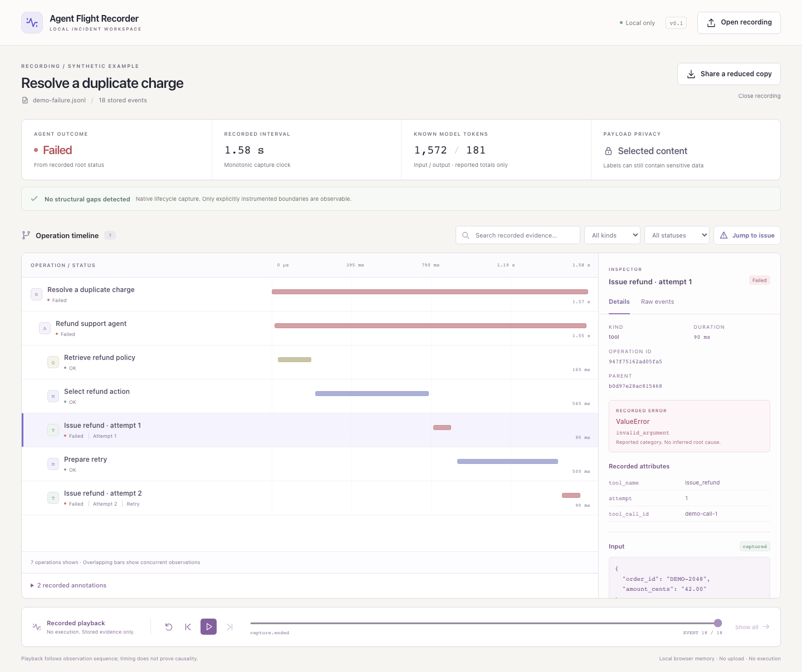

# Agent Flight Recorder

**An offline incident viewer for AI agents.** Record instrumented operations into one portable file, follow the timeline, and see which evidence was captured, omitted, or left unfinished.

This is a standalone, framework-independent portfolio project. Version 0.1 is an alpha for local debugging: Python capture, a React/TypeScript viewer, and a documented JSONL format. No account, database, collector, provider SDK, or model credentials are required.



## Try it locally

Requires Python 3.11 or later. The repository includes a built viewer; Node is needed only to develop it.

```sh
python3 -m venv .venv
source .venv/bin/activate
python -m pip install -e .
afr view
```

The command opens a loopback-only viewer. Choose **A failed attempt** to inspect a refund agent that repeats an invalid argument, or open your own recording with the file picker. File contents stay in browser memory and are never uploaded to the viewer server. The examples make no model calls and perform no payments or other external actions.

The package is not published to a registry. Install it from this checkout or a locally built wheel.

## Record your own code

```python
from agent_flight_recorder import Recorder

with Recorder("run.jsonl") as recorder:
    with recorder.run("Support request"):
        with recorder.span("tool", "Lookup order") as span:
            result = your_lookup_function()  # Your code still calls the tool.
            span.set_output(result)         # Omitted in default metadata mode.
```

Use `capture_content=True` to opt into filtered inputs and outputs. Pass `input=` to a span and call `span.set_usage(input_tokens=..., output_tokens=...)` when those values are available. Static names and allowlisted metadata remain visible by default, so do not put secrets in labels. See [privacy and threat model](docs/privacy.md).

Recording uses synchronous, flushed writes and adds overhead. It observes explicitly instrumented boundaries; it does not discover every action automatically. Recorder failures preserve application results and original exceptions. An unmatched operation remains **incomplete**, never automatically failed. A recording with no detected gaps still cannot prove that every action was instrumented.

Sync context managers work inside asynchronous functions. New asyncio tasks inherit their context; threads should receive an explicit `parent_span_id` or an explicitly copied context. Each recording has one writer process. See [the contract](docs/contract.md) for fields and limits.

## Local commands

```sh
afr demo --output recordings/demo
afr validate recordings/demo/demo-success.jsonl
afr import-otlp trace-export.json --output imported.jsonl
afr view --no-open --port 8765
python examples/record_agent.py --output recordings/example.jsonl
```

All output recordings are new files; existing ones are not overwritten. `validate` exits 0 for a valid capture without evidence warnings, 1 for a readable recording with warnings, and 2 for invalid input. `--allow-partial` explicitly permits recovery past malformed middle records. `import-otlp` accepts one documented OTLP JSON shape, requires `--trace-id` for multiple traces, and omits source content by default. See [interoperability](docs/interoperability.md).

## What playback means

Playback moves through **already recorded evidence**. It never executes tools, reruns a model, restores process state, or undoes an action. Deterministic execution replay, live ingestion, orchestration, guardrails, cloud hosting, and automatic root-cause claims are outside this release.

An imported completed span does not prove its start was recorded before a crash. Imported times and ordering come from the source, not the conversion time. Missing or redacted evidence cannot be reconstructed.

## Develop and verify

```sh
python -m pip install -e '.[dev]'
python -m pytest
cd viewer
npm ci
npm test
npm run build
cd ..
python -m build
```

The build emits the viewer into the Python package. Runtime capture has no third-party dependencies. Frontend dependencies are pinned in the npm lockfile. CI covers Python on macOS and Linux; successful local verification and pending external checks are recorded separately in [validation](docs/validation.md).

## Project guide

- [Architecture](docs/architecture.md): boundaries, storage, and data flow.
- [Event contract](docs/contract.md) and [JSON Schema](schema/event.schema.json): format and validation rules.
- [Privacy](docs/privacy.md): content capture, sharing, and security limits.
- [Interoperability](docs/interoperability.md): tested import subset and losses.
- [Demo walkthrough](docs/demo-walkthrough.md): inspect a failure in 90 seconds.
- [Approved master plan](docs/master-plan.md): research, milestones, and deferred scope.

Existing tools already provide excellent tracing and debugging. This project explores a deliberately small portable incident workflow, not a new observability category. The working title is shared by unrelated projects; this repository is independently implemented. See the research in the master plan for OpenTelemetry, OpenInference, Langfuse, Phoenix, LangSmith, and direct alternatives.

MIT licensed. Only reviewed synthetic recordings belong in this repository. Real recordings are ignored by Git by default.
