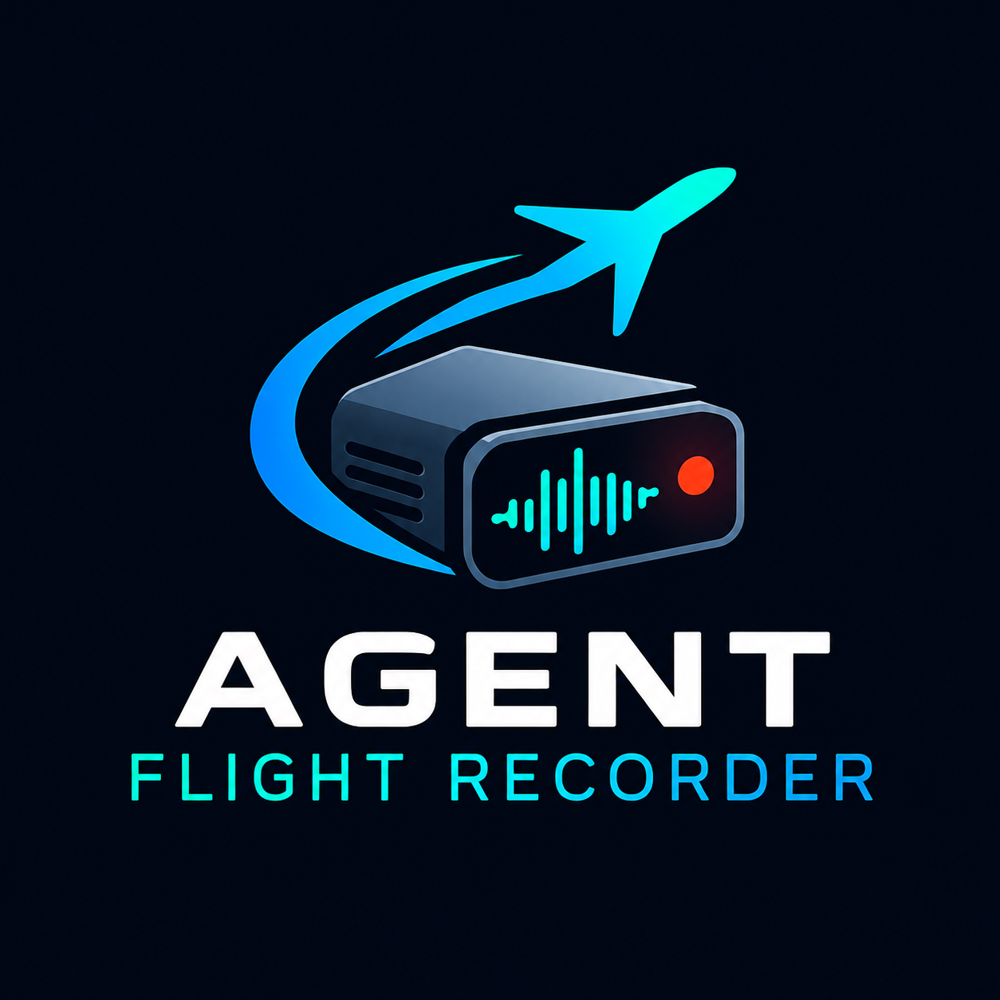
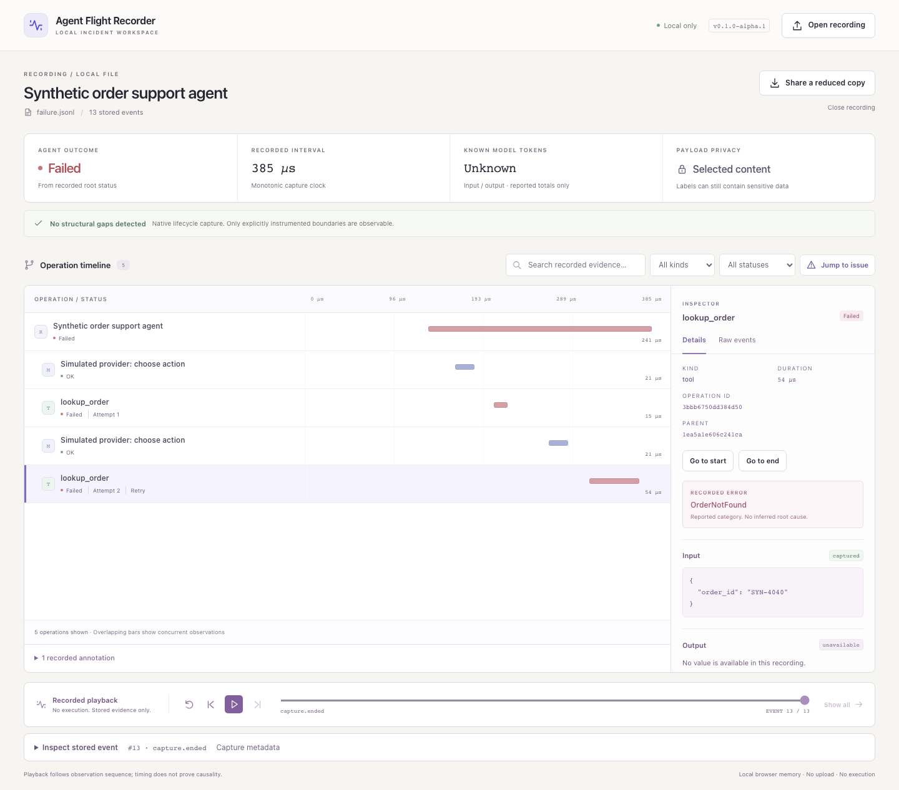

# Agent Flight Recorder

<p align="center"></p>

**Understand what an AI agent actually did—and what the recording cannot tell you.**

Capture explicitly instrumented operations into a portable JSONL file. Inspect model and tool boundaries, timing, retries, failures, and missing evidence in a local timeline. Step through recorded events without executing them again.

Standalone and framework-agnostic. No account, database, collector, model credentials, or Python runtime dependencies. The viewer is bundled with the package. Alpha version: **v0.1.0-alpha.1** (Python package version `0.1.0a1`). This is alpha software for local debugging. See [GitHub Releases](https://github.com/Leogy101/agent-flight-recorder/releases) for release assets; there is no PyPI release.



[Watch the short browser demonstration](docs/screenshots/agent-demo.webm) · [Follow the narrated walkthrough](docs/demo-walkthrough.md)

## Useful when

- A tool fails after several model decisions: inspect its recorded arguments, error category, and explicit retry relationship.
- An agent stops unexpectedly: distinguish an observed failure from an operation with no recorded end.
- A teammate needs a small incident artifact: preview a reduced copy without running a collection service.

## Five-minute quickstart

With **Python 3.11–3.14** installed (macOS or Linux), clone the alpha tag and enter its directory:

```sh
git clone --branch v0.1.0-alpha.1 --depth 1 https://github.com/Leogy101/agent-flight-recorder.git
cd agent-flight-recorder
```

Then install and run:

```sh
python3 -m venv .venv
source .venv/bin/activate
python -m pip install --upgrade 'pip>=26.2'
python -m pip install -e .
python examples/record_agent.py --output-dir recordings/first-run --capture-content
afr view
```

Node is unnecessary to run the bundled viewer. The installation steps may download build tools; recording and viewing then work offline. The package is not on a registry: use this checkout or a locally built wheel.

In the viewer, choose **Open a recording** and select `recordings/first-run/failure.jsonl`. Inspect the two `lookup_order` attempts: the first receives an integer and fails validation; the corrected string names an absent order, so the second call and the agent fail. Then open `success.jsonl`: the corrected lookup succeeds and the agent returns an answer. Use the event controls to inspect what was known at each step.

The example **executes Python code and a read-only local catalog lookup**. Its provider is an explicitly labeled deterministic stand-in, not an LLM. No paid API or network is involved. `--capture-content` enables filtered synthetic inputs/outputs for inspection; omit it to use metadata-only capture. Repeating the command requires a new destination, or omit `--output-dir` for a fresh private temporary directory. See the [example guide](docs/example.md) and [90-second demonstration](docs/demo-walkthrough.md).

## Why this exists

An incident can be difficult to share when its evidence depends on a running observability stack. This project explores a small alternative: **one bounded recording, one local viewer, and explicit uncertainty**. It distinguishes application failure, recorder loss, unfinished work, intentional omission, and conflicting evidence.

It complements existing tools rather than claiming a new tracing category:

| Tool | Where it fits | This project's narrower scope |
| --- | --- | --- |
| [OpenTelemetry](https://opentelemetry.io/docs/) / [OpenInference](https://github.com/Arize-ai/openinference) | Telemetry standards and instrumentation for existing pipelines | Dependency-free explicit Python capture plus a limited file-only OTLP JSON adapter |
| [Langfuse](https://langfuse.com/docs) | Broader LLM observability, evaluation, and prompt workflows | A single-run incident file, without operating a platform |
| [Phoenix](https://arize.com/docs/phoenix) | Tracing and evaluation, including local use | A small portable evidence format and bounded offline inspection |
| [LangSmith](https://docs.langchain.com/langsmith/home) | A proprietary observability and evaluation platform; not an open-source alternative | A standalone MIT-licensed local tool with no service account |

See the [research and original build plan](docs/master-plan.md) for licensing distinctions and direct alternatives. Other unrelated projects use the same working name; no affiliation or unique invention is claimed.

## Instrument your code

```python
from agent_flight_recorder import Recorder

with Recorder("run.jsonl") as recorder:
    with recorder.run("Support request"):
        with recorder.span("tool", "Lookup order", input={"order_id": "SYN-1001"}) as span:
            result = your_lookup_function()  # Your application invokes the tool.
            span.set_output(result)         # Content is omitted by default.
```

Opt into selected content with `capture_content=True`; add `redact_keys` and literal `redact_patterns` for your data. Filtering occurs before persistence. Labels and allowlisted metadata remain visible, so keep secrets out of operation names. Content filtering is not a guarantee of anonymity. See [privacy and security](docs/privacy.md).

Recorder failures preserve application results and original exceptions while reporting degraded evidence through `recorder.health` and, where writing remains possible, the file. It performs synchronous writes and adds overhead. One recording has one root run and one writer process. Sync context managers work inside async functions; threads need explicit parent IDs or copied context. Use a new `Recorder` for each run and a fresh span object for each scope.

## Commands and files

```sh
afr demo --output recordings/demo
afr validate recordings/demo/demo-success.jsonl
afr import-otlp trace-export.json --output imported.jsonl
afr view --no-open --port 8765
```

Recordings are created exclusively; existing files are not overwritten. `validate` exits **0** for no evidence warnings, **1** for readable but uncertain evidence, and **2** for invalid input. A recorded application failure can still validate cleanly. `--allow-partial` permits skipping malformed middle records with warnings. OTLP conversion requires explicit trace selection when several traces are present and omits source content by default.

The built-in refund/delivery demos are hand-authored synthetic illustrations. The [executing agent example](examples/record_agent.py) and [reviewed execution samples](fixtures/README.md) are separately identified. User-selected recordings stay in browser memory; the loopback server serves assets and bundled demos only.

## Playback, not execution replay

Playback reveals saved evidence in recorded order. It never calls a model, invokes a tool, reads the example catalog again, restores memory, or undoes an action. Missing and redacted content cannot be recovered. Rerunning the example creates a new execution with new IDs and measured timing; deterministic application outcomes do not imply byte-identical recordings.

OTLP imports reconstruct lifecycle records from exported spans. They cannot recover an operation that never exported. Missing endpoints remain incomplete, UNSET status remains unknown, and source timestamps—not conversion time—position imported operations. See the [interoperability contract](docs/interoperability.md).

## Architecture and measured limits

Your application invokes the model/tool → explicit Python scopes filter and append events → a browser file picker opens the recording → an in-memory timeline displays saved evidence. The local server serves static assets only. There is no data ingestion API. See [architecture](docs/architecture.md) and [the event contract](docs/contract.md).

Default bounds are 25 MiB per recording, 10,000 events, 64 KiB per event, and 8 KiB per opted-in payload. The alpha qualification on an Apple M4 Pro opened 10,000 events (3.95 MB) in 359 ms, filtered in 6 ms, and recorded empty tool scopes at 21.625 μs median / 26.833 μs p95. These are synthetic observations, not production guarantees. [Validation](docs/validation.md) records release-candidate measurements, exact environments, and reproduction commands.

## Develop and verify

Use Node 24 for frontend development, matching CI:

```sh
python -m pip install -e '.[dev]'
python -m pytest
cd viewer
npm ci
npm test
npm run build
npx playwright install chromium
cd ..
node tests/browser-check.mjs
python benchmarks/capture.py --output work/capture-benchmark.json
python -m build
```

The CI workflow tests Python on macOS/Linux, checks the installed wheel, and runs viewer unit tests and real Chromium acceptance. Check [GitHub Actions](https://github.com/Leogy101/agent-flight-recorder/actions) for results on the commit you use. The [prepublication local qualification snapshot](docs/validation.md) records measured test counts, performance, and tested platforms; it does not establish remote CI status.

## Near-term roadmap

Qualify the alpha with unfamiliar developers, improve keyboard/screen-reader usability based on feedback, and add concrete interoperability fixtures when users encounter unsupported exports. Broader browser/OS support comes with verification, not assumption. Cloud collection, orchestration, automatic instrumentation, and execution replay are outside this alpha's scope.

## Project guide

- [Architecture](docs/architecture.md), [event contract](docs/contract.md), and [JSON Schema](schema/event.schema.json).
- [Engineering review](docs/engineering-review.md): confirmed findings, fixes, and deferred work.
- [macOS startup investigation](docs/macos-startup.md): a resolver stall found during remote release qualification.
- [Dependencies and supported environments](docs/dependencies.md).
- [Privacy boundaries](docs/privacy.md), [security reporting](SECURITY.md), and [contributing](CONTRIBUTING.md).
- [Release preparation](docs/release-checklist.md), [alpha release notes](docs/release-notes-v0.1.0-alpha.1.md), [publication instructions](docs/publication.md), and [change log](CHANGELOG.md).

MIT licensed. Independently implemented; not an OpenClaw component, fork, or official integration. Bundled third-party notices are included. Only reviewed synthetic recordings belong in the repository; real recordings are ignored by Git.
