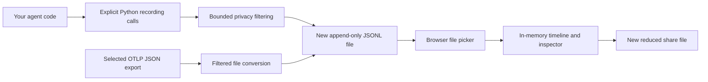

# Architecture

The recording is the product's source of truth. There is no database or running collection service.

The Python package has no runtime dependencies. `Recorder` assigns IDs and monotonic timestamps, tracks nesting with context variables, filters data, and writes complete flushed lines under one lock. Each file belongs to one process. Threads can supply an explicit parent; asynchronous tasks retain their own context.

The recorder attempts to write a start before the application invokes the operation and an end afterward. This is synchronous I/O and changes timing. It does not wrap a network transport, monkey-patch a framework, retry an operation, or consume a stream on the application's behalf. Missing endpoints and failed writes degrade evidence rather than changing the application's intended result or original exception. Flushing is not fsync or a durability promise after power loss.

`recording.py` handles bounded parsing and evidence-quality checks. `otlp.py` converts a selected trace from a documented OTLP JSON representation. Imported operations preserve source intervals and their reconstructed provenance; conversion time does not become execution time.

The browser runs a React/TypeScript bundle with no remote fonts, analytics, or service dependencies. It reads selected recordings in memory and builds temporary indexes. Native elapsed time positions the timeline; the event cursor reveals already recorded evidence. Imported chronology uses source timestamps and a disclosed tie order. The inspector displays content as text, never as executable HTML or fetched media.

The Python HTTP server serves an allowlist of bundled static files on `127.0.0.1`. It does not expose a filesystem browser, upload, ingestion endpoint, shell, or arbitrary proxy. The only recording files served are reviewed, bundled synthetic examples. The browser does not send user-selected recording content to the server. Host checks, content security policy, no-store responses, and no cross-origin data API limit the local surface.

## Limits and tradeoffs

One native file has one trace and one recording ID. Defaults cap files at 25 MiB, events at 10,000, lines at 64 KiB, opted-in payloads at 8 KiB, and JSON container depth at 20. Import conversion preflights generated output against those bounds. These limits make a database-free local viewer practical; they are not claims about production-scale collection.

Capture closure, application outcome, and payload availability are independent. A closed file may contain unfinished operations; a successful root may lack recording finalization; omitted content may be intentional. Parent links describe nesting and explicit links describe supplied relationships. Neither timestamp sorting nor repeated operation names proves causality.

A reduced export is a new artifact rebuilt from an allowlist. It keeps evidence warnings and relative timing, replaces labels, remaps IDs, and removes payloads and arbitrary metadata. It never edits the original file.

## Deliberate exclusions

Version 0.1 has no live ingestion, background recorder worker, distributed capture, multi-run index, execution engine, automatic instrumentation, accounts, model pricing catalog, or AI-generated diagnosis. Adding a feature should address a demonstrated need without weakening the evidence contract. True execution replay would require a separate design for nondeterminism, external state, and side effects.
