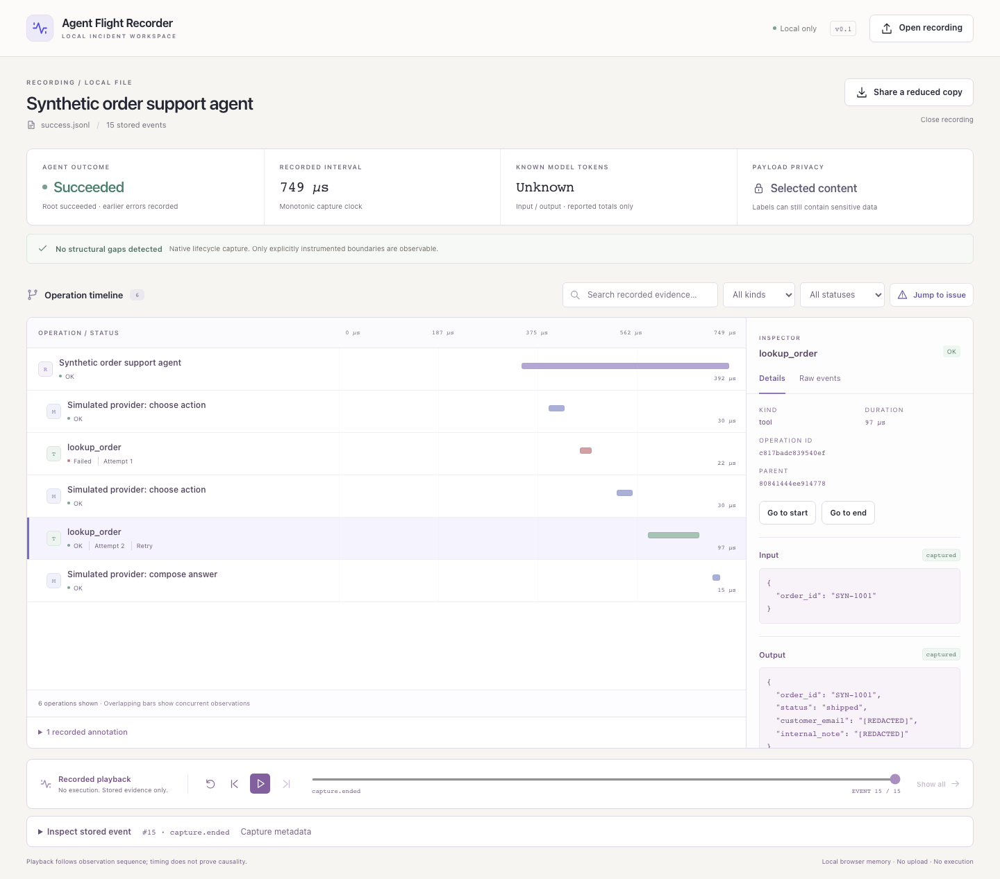

# A 90-second portfolio demonstration

This walkthrough uses an **executing local agent**, not an assembled trace. The provider is a deterministic stand-in and all data is synthetic. No model API, payment, network request, or catalog modification occurs.

[Watch the short browser clip](screenshots/agent-demo.webm). To regenerate it after building the viewer, run `node scripts/record-demo.mjs`; Playwright Chromium must be installed. The longer narration below is a script for a live portfolio walkthrough.

## Prepare

From an installed checkout:

```sh
python examples/record_agent.py --output-dir recordings/portfolio-demo --capture-content
afr view
```

Use a new directory each time. The command prints both saved recordings and confirms that the failed scenario was expected. The [example guide](example.md) explains the actual control flow and metadata-only option.

## Show the project

1. **0–15 seconds — Open the failed run.** Choose `failure.jsonl`. Point out the failed agent outcome, normal capture closure, unknown token usage, and explicit selected-content policy. The model rows identify the simulation.
2. **15–35 seconds — Inspect the tool calls.** `lookup_order`, attempt 1, received integer `4040` and raised `InvalidToolArguments`. Attempt 2 received string `SYN-4040`, then raised the real local `OrderNotFound`. An explicit retry relationship connects the attempts.
3. **35–55 seconds — Inspect playback.** Choose **Go to start**, then **Go to end**, or step the event cursor. The root outcome is not known before its end is reached. Expand **Inspect stored event** to see the exact saved observation. Playback does not call the tool again.
4. **55–75 seconds — Compare recovery.** Open `success.jsonl`. The first argument error is handled, the corrected lookup returns `shipped`, and the root succeeds. Show the note that earlier errors were recorded. Email and internal-note values are redacted even in this opted-in example.
5. **75–90 seconds — Explain the boundary.** Preview **Share a reduced copy**: content, labels, and identifiers change while uncertainty remains visible. This is a debugging artifact, not a deterministic execution replay, a full observability platform, or proof of complete capture.



For a second short example, open the bundled **An interrupted run** illustration. A missing tool end and missing root/capture closure mean incomplete evidence, not automatic failure. Built-in refund/delivery demos are hand-authored illustrations; they are separate from the executed support-agent samples above.

The screenshots and short browser clip use synthetic recordings only. Runtime durations vary; no artificial sleeps are inserted into the recorded agent to manufacture model latency. Pauses in the demonstration are for the person watching the viewer.
